# Assignment 4 — State and User Interaction in Jetpack Compose

Android Basics with Compose, Unit 2, Pathway 3:
https://developer.android.com/courses/pathways/android-basics-compose-unit-2-pathway-3

## Projects

| # | Folder | Codelabs |
|---|--------|----------|
| 1 | `01-tip-time/` | Intro to state in Compose, Calculate a custom tip, Write automated tests |
| 2 | `02-art-space/` | Project: Create an Art Space app (including the screen sizes challenge) |

### 01 Tip Time

- **Intro to state in Compose** — `TextField`, `mutableStateOf`, `remember`, recomposition, state hoisting
- **Calculate a custom tip** — tip percentage field, `ImeAction.Next` / `ImeAction.Done`, round up `Switch`, `verticalScroll` for landscape, leading icons (optional task, see `01-tip-time/TASKS.md`)
- **Write automated tests** — local test `TipCalculatorTests` and instrumentation test `TipUITests`

### 02 Art Space

Requirements and low fidelity prototype are in `02-art-space/TASK.md`.

- Three sections: artwork wall, artwork descriptor, display controller
- `Previous` / `Next` buttons with wraparound in both directions
- Artworks stored as a list of `Artwork` data class objects, current artwork kept with `rememberSaveable`
- Side by side layout on wide screens and limited width on tall screens (challenge)
- Instrumentation tests `ArtSpaceUITests` for navigation and wraparound
- Artwork images are public domain paintings from Wikimedia Commons

## Running tests

```bash
cd 01-tip-time && ./gradlew testDebugUnitTest connectedDebugAndroidTest
cd 02-art-space && ./gradlew testDebugUnitTest connectedDebugAndroidTest
```

## Screenshots

| Tip Time | | |
|---|---|---|
| 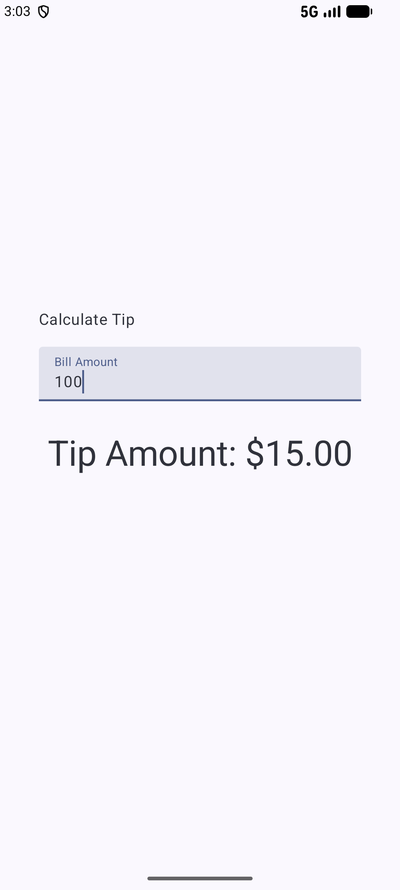 | 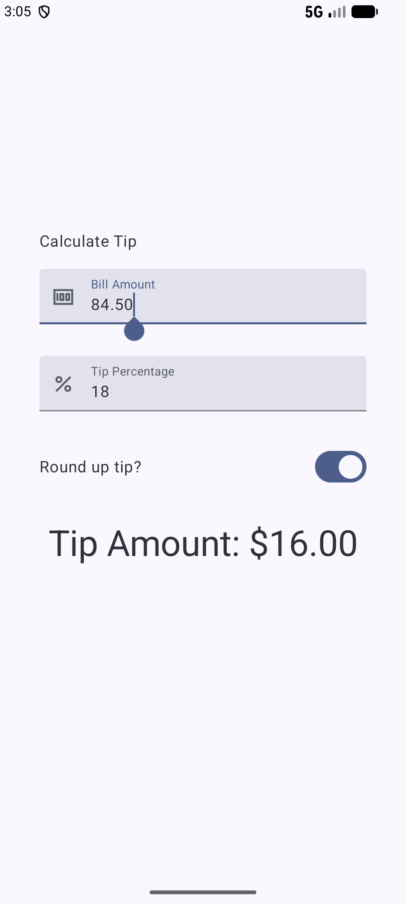 | 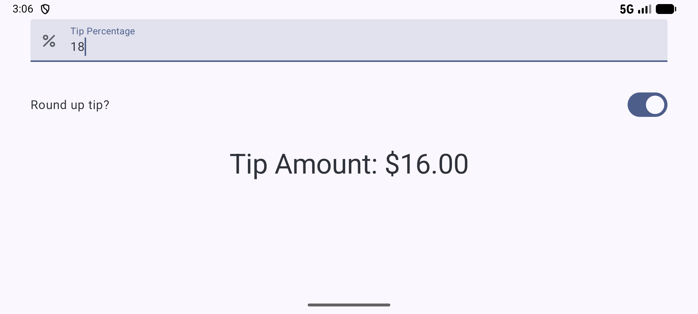 |

| Art Space | | |
|---|---|---|
| 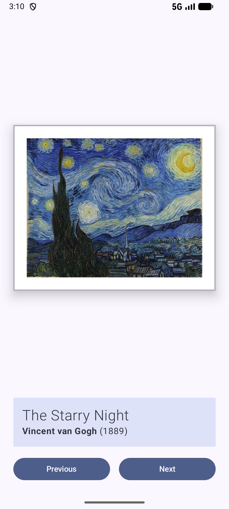 | 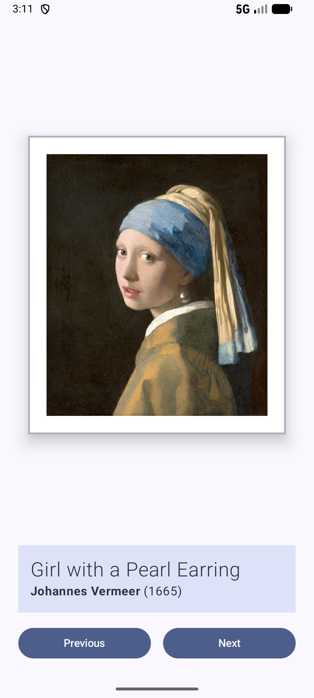 | 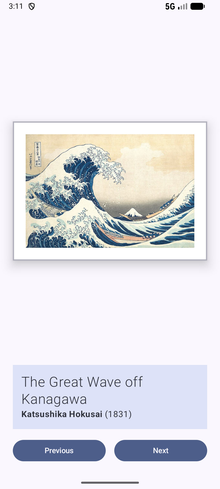 |
| 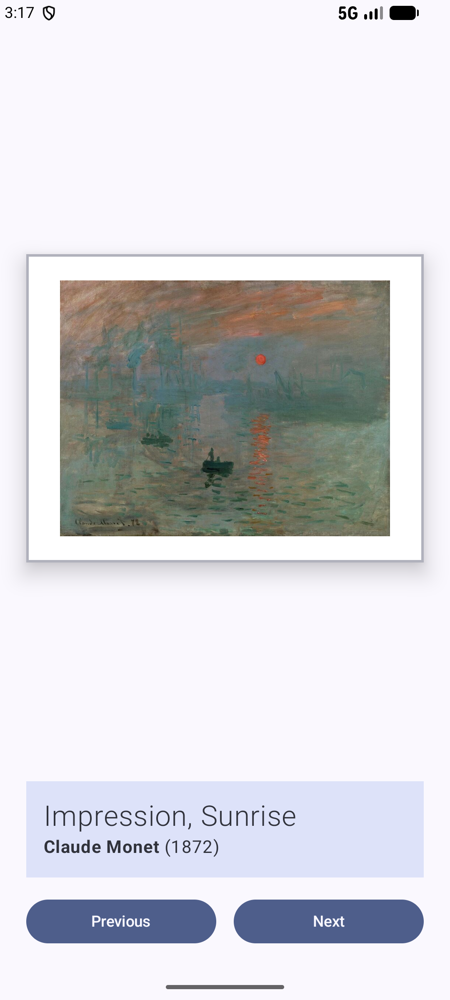 | 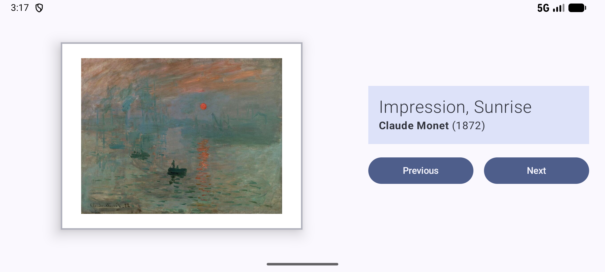 | 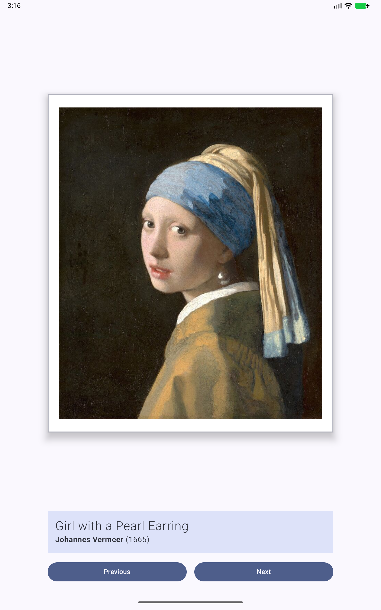 |

Tablet landscape before and after the challenge fixes:

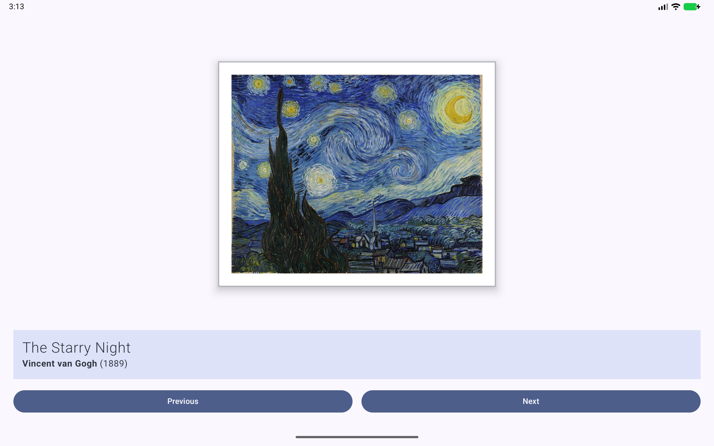
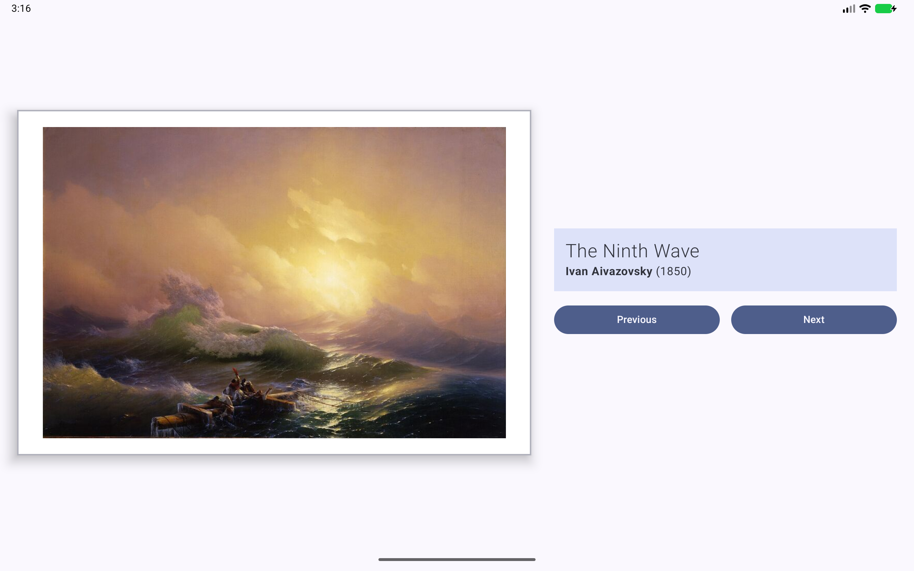
